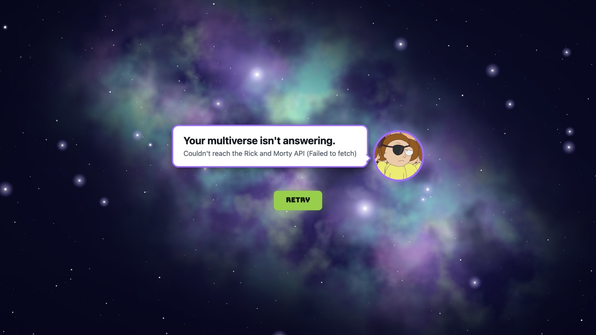

# Healthie pairing: React Kanban board

A frontend-only Kanban board (To Do, Doing, Done) where every item is assigned a
character from the [Rick and Morty GraphQL API](https://rickandmortyapi.com/graphql).


<details>
<summary>The error screen, when the Rick and Morty API can't be reached</summary>



</details>

## Running it

Needs Node 24 (see `.nvmrc`).

```bash
npm install
npm run dev      # http://localhost:5173
npm test         # unit and component tests (Vitest)
npm run lint     # oxlint
npm run build    # type-check and production build
```

## What it does

- **Loads characters** from the Rick and Morty GraphQL API with a plain `fetch` call,
  behind a portal loader. If the API can't be reached, Evil Morty breaks the news
  in a speech bubble, with a Retry button underneath.
- **Creates items with a form.** Each item needs a title and a character. The character
  picker is a searchable dropdown: it opens on the first 20 characters and searches the
  API by name as you type (debounced, cancelling stale requests). **Add** stays disabled
  until both a title and a character are filled in.
- **Drag and drop** between columns and within a column, with mouse, touch, or keyboard
  (focus a card, **Space** to pick it up, arrow keys to move, **Space** to drop,
  **Escape** to cancel). The dragged card swings as you move it.
- **Something delightful:** adding an item pops up Mr. Meeseeks with "Caaan do!", and
  moving an item into Done gets Mr. Poopybutthole saying "Ooo-wee!" plus confetti.
- Starts with four sample items so the board isn't empty. Each card has a remove button.

## How it's built

```
src/
  types.ts                    Character, Item, ColumnId, BoardState
  api/characters.ts           the GraphQL fetch
  board/boardReducer.ts       add / move / remove, plus the sample board
  hooks/
    useCharacters.ts          loading / error / ready for the first load, with retry
    useCharacterSearch.ts     debounced, cancellable search for the picker
    useDragSwing.ts           turns drag speed into a springy tilt
  components/                 one folder per component: Name.tsx, Name.module.css,
                              index.ts (and Name.test.tsx where there is one)
    BoardScreen/              owns the board state (useReducer), header and form
    Board/                    dnd-kit context, drag handlers, celebration
    Column/                   a droppable column with a sortable list
    ItemCard/                 the sortable card, and the copy that follows the pointer
    NewItemForm/              title, character picker, Add
    CharacterPicker/          Downshift combobox
    PortalLoader/             loader and error screen
    Portal/                   the portal, drawn in SVG
    SpaceBackground/          the nebula and stars, drawn in SVG
    SpeechToast/              headshot plus speech bubble (toasts and the error screen)
  toasts.tsx, celebrate.ts    the Meeseeks / Poopybutthole toasts and the confetti
  setupTests.ts               test setup (jest-dom matchers, cleanup)
```

Tests sit next to the code they test (`*.test.ts(x)`).

## Choices and why

- **Vite + React 19 + TypeScript.** Create React App is deprecated, and this doesn't need
  a framework like Next.js since there's no server.
- **Plain `fetch` for GraphQL.** It's one POST with a query and variables. Apollo or urql
  would add caching and a provider, which this app doesn't need.
- **`useReducer` for board state.** Moving a card touches two columns at once, so every
  change is a named action (`ADD_ITEM`, `MOVE_ITEM`, `REMOVE_ITEM`) in one pure,
  unit-tested function. Items are stored by id, and each column is an ordered list of ids,
  so a move only touches the id lists. `useState` would work too, but the update logic
  would end up spread across event handlers. Zustand or Redux would be overkill for one
  board, and the component tree is shallow enough that Context isn't needed.
- **dnd-kit for drag and drop.** I've used `react-beautiful-dnd` before, but it's
  deprecated. dnd-kit is maintained, works with React 19, and has keyboard and screen
  reader support built in. The screen reader announcements use item titles and column
  names rather than ids.
- **The swing is hand-rolled** (`useDragSwing`): a small spring simulation driven by
  horizontal drag speed. It writes the rotation straight to the element each frame
  instead of going through React state, so the card doesn't re-render 60 times a second.
- **Downshift for the picker.** A combobox has a lot of keyboard and ARIA behavior that's
  easy to get subtly wrong. Downshift handles that, and the markup and styles are ours.
- **Toasts instead of sound.** Real audio clips from the show are copyrighted, so they
  don't belong in a public repo, and sound is unwelcome on a screen share anyway. The
  headshots and avatars are hotlinked from the API, never stored in the repo. The portal
  is drawn from scratch in SVG and CSS.
- **sonner** handles toast stacking and timing. **canvas-confetti** handles the confetti.
- **CSS Modules** per component, with the palette in CSS variables in `styles/global.css`.
  The space background and portal are drawn in SVG/CSS. The title font (Bungee, SIL Open
  Font License) is bundled through `@fontsource`, so nothing loads from a font service.
- **Motion respects `prefers-reduced-motion`:** no swing, no confetti, and a slower portal.

## Tradeoffs and what I'd revisit

- **API resilience.** No caching yet, so every search hits the API. In production I'd
  cache searches (or use a client like TanStack Query), and handle rate limits and
  timeouts explicitly.
- **Search only shows the first page of matches** (up to 20). Common names like "Rick"
  have more. That's fine for picking a character, but it could load more on scroll.
- **Item ids** come from `crypto.randomUUID()`, which is fine on the client. With a
  backend, the server would assign them.
- **Testing.** The reducer, API module, hooks, and form have unit and component tests.
  Drag and drop is hard to test in jsdom, so I checked it in a real browser. Next I'd add
  Playwright tests for drag flows, including keyboard dragging.
- **Very large boards** would want list virtualization, and probably state keyed by
  column on a server with optimistic updates.
